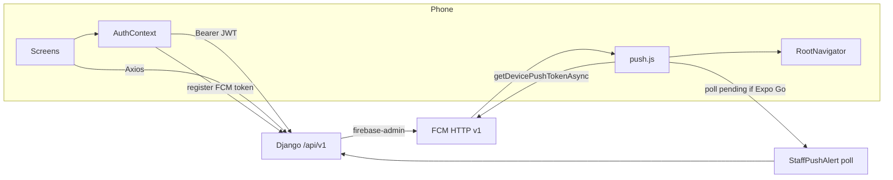

# Mobile app — system architecture

Staff Expo app for InvoiceFlow. Lives in `app/mobile/`. Talks only to the Django API (`/api/v1`).

Backend / platform architecture: `docs/SYSTEM_ARCHITECTURE.md`  
Website architecture: `frontend/docs/SYSTEM_ARCHITECTURE.md`

---

## 1. Purpose

Field and ops staff app: dashboard, invoices/billing, clients, reports, incentives, profile/settings, and **payment received** push banners.

---

## 2. Stack

| Layer | Choice |
|-------|--------|
| Runtime | Expo 56 / React Native |
| Navigation | React Navigation (tabs + native stack) |
| HTTP | Axios (`src/api/client.js`) + JWT refresh |
| State | React Context (`AuthContext`) + lightweight query cache |
| Fonts / UI | Poppins, teal brand theme |
| Push | Native FCM via `expo-notifications` (`getDevicePushTokenAsync`) + Django `firebase-admin` HTTP v1 |
| Builds | EAS (`eas.json`) → Play Store / App Store |

---

## 3. Folder map

```
app/mobile/
  App.js                 # fonts, providers, nav + push listeners
  app.config.js          # Expo config (notifications, FCM file hook)
  eas.json               # development / preview / production
  src/
    api/                 # Axios client, cache
    context/             # Auth
    navigation/          # RootNavigator, tabs
    screens/             # feature screens
    notifications/       # push.js (register, poll, local banners)
    components/          # shared UI
    theme / typography
  docs/                  # this folder
```

---

## 4. Runtime diagram



---

## 5. Auth flow

1. `LoginScreen` → `POST /auth/login/`
2. Persist access/refresh + user in AsyncStorage
3. Axios interceptor attaches `Authorization: Bearer …`
4. On 401 → refresh via `/auth/login/refresh/` or sign out
5. After login / session restore → `registerPushTokenWithBackend()`
6. On sign out → unregister push + clear storage

---

## 6. Feature surfaces

| Tab / stack | Screens |
|-------------|---------|
| Home | Dashboard, create billing shortcut |
| Invoices | List, detail, editor, create billing |
| Reports | Range reports, paid transactions |
| Profile | Settings, avatar, sign out |
| Stack | Clients, incentives (AM/admin), calendar, misc |

API base: LAN Django in dev (`0.0.0.0:8000` via Expo host IP); production API host via env / build config.

---

## 7. Notifications architecture

See **[PUSH_NOTIFICATIONS.md](./PUSH_NOTIFICATIONS.md)** for full setup (Expo Go, EAS, stores).

Summary:
- Payment paid on backend → `StaffPushAlert` + FCM HTTP v1 notification
- App registers native FCM token on login (`getDevicePushTokenAsync`)
- Android system tray shows the message even when the app is killed
- Expo Go Android cannot receive remote push (SDK 53+) → polls `/notifications/alerts/pending/` while open

---

## 8. Environments

| Env | How to run |
|-----|------------|
| Local + Expo Go | `npx expo start --host lan` + Django `0.0.0.0:8000` |
| EAS development | `eas build -p android --profile development` |
| Production stores | `eas build --profile production` + FCM/APNs |

---

## 9. Design constraints

- Physical device required for real push testing
- Do not point production builds at LAN IPs
- Keep push registration non-blocking (login must succeed even if push fails)
- Prefer API feature parity with web for staff workflows; web remains the heavier admin console
